# The Wandering Blade - CS464 Lab07

**Name:** Muhammad Abdullah Usman
**Roll Number:** BSCS25061

A functional menu system for a landscape mobile sword training game. Ten connected menu screens support chapter selection, equipment, upgrades, settings, pausing and mission results. A simple interactive mission provides a playable connection between preparation, pause and results.

## Demo and Windows Build

- [Watch the navigation demo](https://drive.google.com/file/d/1LHcVYHw009eleIxRwgYQMS5deLSAm9Zp/view?usp=sharing)
- [Download the Windows build](https://drive.google.com/file/d/14DJ4t9oUIPDolcvmAVpFRmQsoRn6uGTS/view?usp=drive_link)

Download and extract complete Windows ZIP before running the executable.
The Windows build is provided for assessment, following the instructor's clarification that Windows builds are acceptable.

## Setup and Run

1. Clone or download this repository.
2. Open the project through Unity Hub using the version above.
3. Open `Assets/Scenes/MainMenu.unity1.
4. Select a landscape Game view resolution, such as 1280 x 720, and press Play.

To run the Windows build, extract the complete ZIP and launch its executable. Keep all accompanying files and the `_Data1 folder together.

## Design and Implementation

The ten screens belong to one sword-training game. The main flow is:

Title -> Main Menu -> Chapter Select -> Mission Briefing -> Equipment -> Mission -> Pause or Results.

Main Menu also provides access to Upgrades, Settings and Credits. Back controls, Resume, Retry and Main Menu actions provide return routes. The mission HUD supports the menu flow and is additional to the ten documented screens.

### Colour, Typography and Responsive Layout

| Element | Colour | Purpose |
|---|---|---|
| Background | `#EEE7D8` | Warm paper-like foundation |
| Text | `#242622` | Readable contrast |
| Secondary surfaces | `#D8CFBE` | Group information and secondary actions |
| Primary actions | `#8B352D` | Direct attention to the main next step |
| Selected equipment | `#B5A68B` | Reinforce selection |

Spectral SemiBold establishes heading hierarchy. Barlow Medium provides readable body text and button labels. Consistent alignment, grouping, spacing and large button targets support mobile interaction.

The Overlay Canvas uses Scale With Screen Size, a 1920 x 1080 reference resolution and a 0.5 width/height match. Anchors, layout groups and a safe-area container support responsive landscape layouts.

Selection and disabled states use labels and markers as well as colour.

### Tween Techniques

The shared screen transition combines a fade and directional slide:

- **Exit:** 0.12 seconds, **Ease.InCubic**, accelerating the outgoing screen away.
- **Entrance:** 0.24 seconds, **Ease.OutCubic**, settling the incoming screen into position.
- Opposing directions distinguish forward and backward navigation.

Button feedback scales to 96% over 0.07 seconds with **Ease.OutQuad**, then restores over 0.12 seconds with **Ease.OutCubic**. This acknowledges presses promptly and returns smoothly.

Input is blocked during screen transitions. Unscaled tween updates allow menu motion while gameplay is paused. Screen Motion OFF removes screen transitions.

## 01 - Title

**Purpose:** Introduce the game and provide a clear starting action.

**Principles and techniques:** A large serif title establishes hierarchy. Centred alignment and empty space focus attention on the red Start Journey button.

**Tweens and reason:** The initial title appears immediately. Navigation uses the shared InCubic exit and OutCubic entrance. OutQuad press and OutCubic release feedback acknowledge Start Journey.

**Greyscale check:** The title and primary action remain distinct against the background. No additional change was needed.

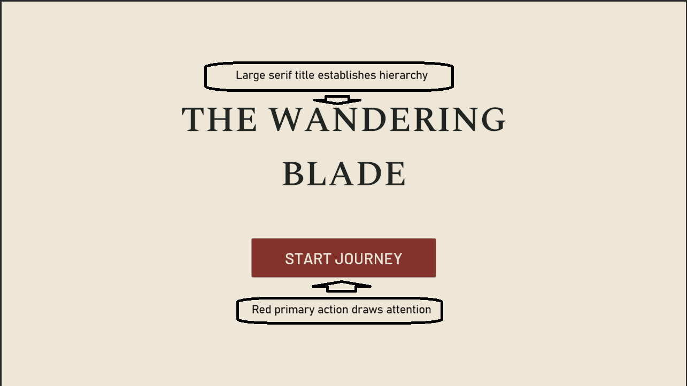

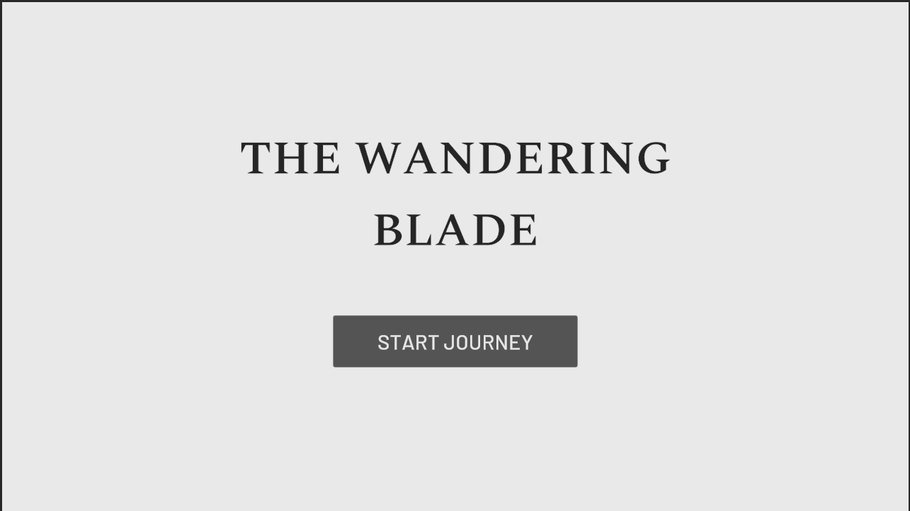

## 02 - Main Menu

**Purpose:** Provide access to the game's main activities and supporting menus.

**Principles and techniques:** Equal button widths and consistent spacing group navigation. Play receives primary emphasis, while secondary destinations share a consistent style.

**Tweens and reason:** InCubic exit and OutCubic entrance communicate navigation. OutQuad press and OutCubic release provide consistent activation feedback.

**Greyscale check:** Play remains darker than secondary buttons, and all labels remain readable. No additional change was needed.

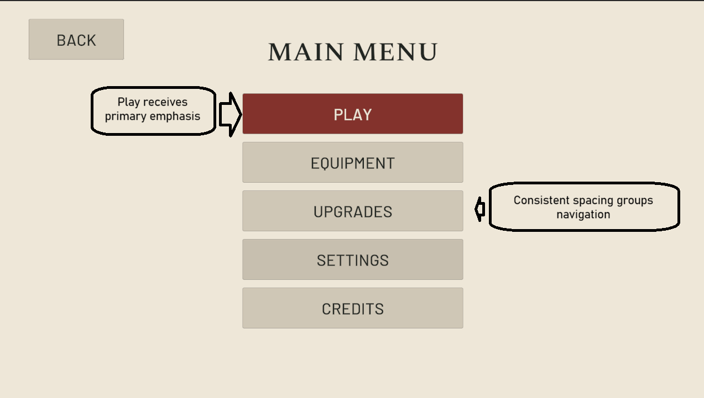

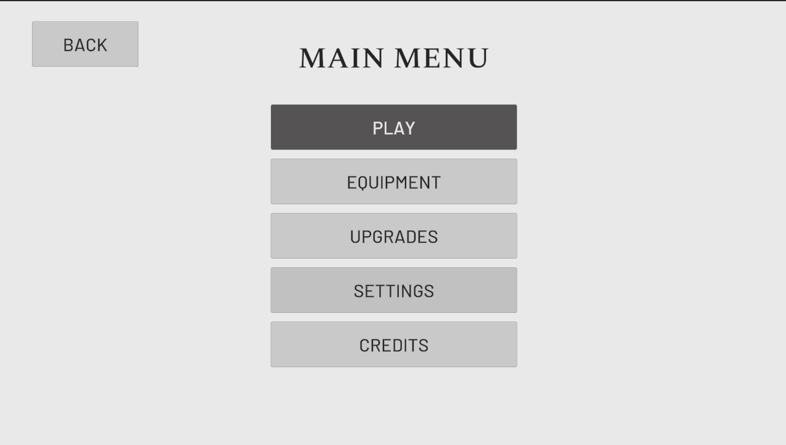

## 03 - Chapter Select

**Purpose:** Let the player choose a mission.

**Principles and techniques:** Numbering communicates chapter order. Equivalent styling presents available choices consistently. Large, separated buttons support touch input, with Back in the usual upper-left position.

**Tweens and reason:** InCubic exit and OutCubic entrance communicate progression to the briefing. OutQuad press and OutCubic release acknowledge chapter selection.

**Greyscale check:** Text, numbering and button boundaries remain clear without hue. No additional change was needed.

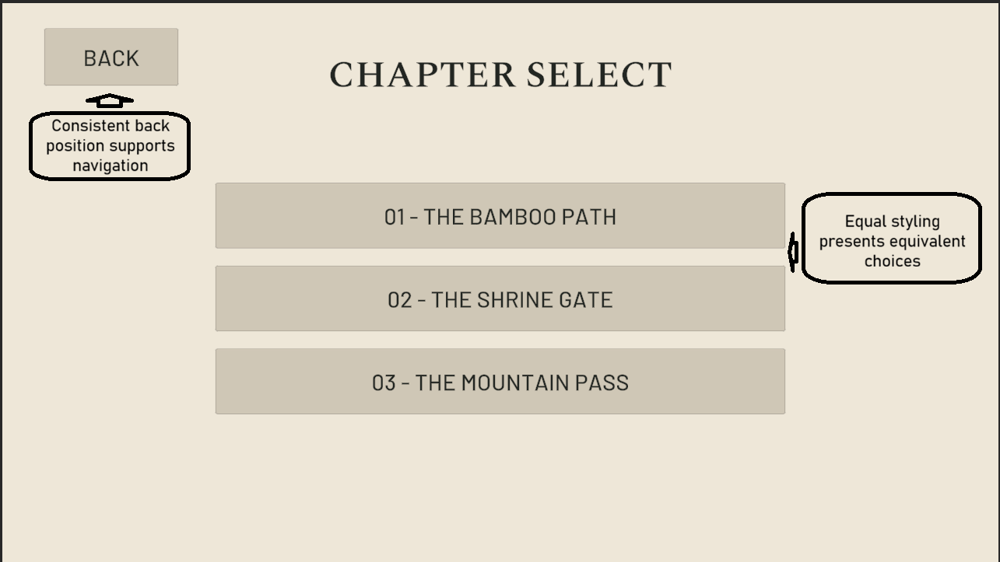

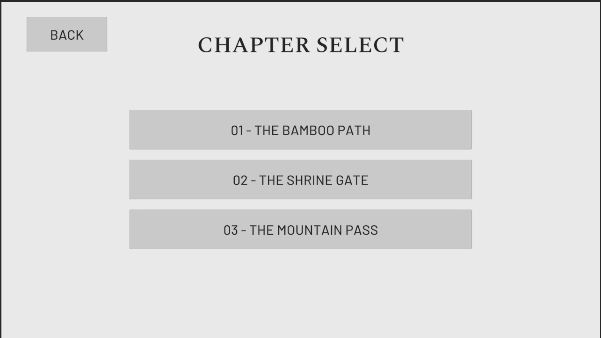

## 04 - Mission Briefing

**Purpose:** Explain the selected mission before preparation.

**Principles and techniques:** Heading sizes establish reading order. A card groups the objective, time limit and reward. Choose Equipment clearly identifies the next step.

**Tweens and reason:** InCubic exit and OutCubic entrance connect selection to preparation. OutQuad press and OutCubic release acknowledge the forward action.

**Greyscale check:** Heading hierarchy, card grouping and primary-button emphasis remain visible. No additional change was needed.

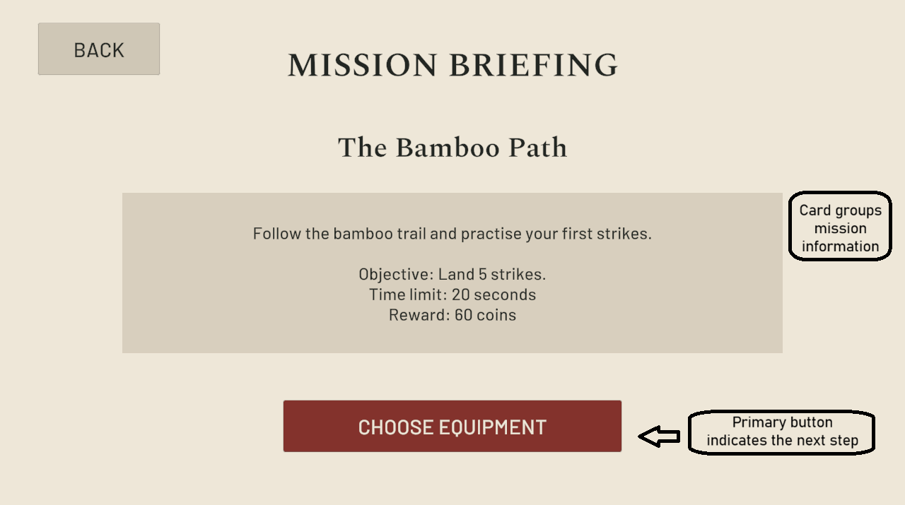

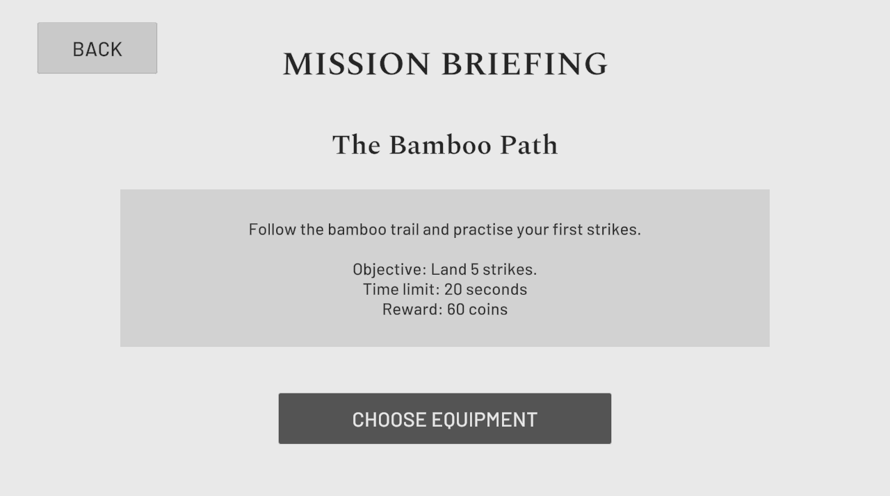

## 05 - Equipment

**Purpose:** Preview and equip a weapon before beginning a mission.

**Principles and techniques:** Aligned rows organise choices. A darker surface, `>` marker and `[EQUIPPED]` label communicate state. Descriptions explain the selection. The equipped action is disabled, while Begin Mission receives primary emphasis.

**Tweens and reason:** InCubic exit and OutCubic entrance preserve navigation continuity. OutQuad press and OutCubic release acknowledge selections and actions.

**Greyscale check:** Selection remains identifiable through lightness, the marker and the equipped label. Active and disabled actions remain distinguishable. No additional change was needed.

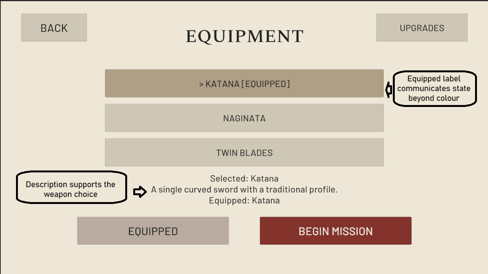

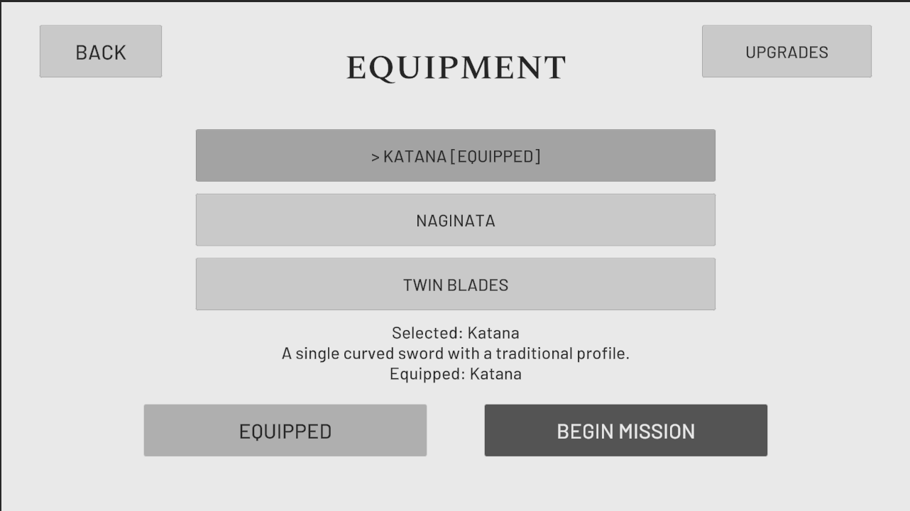

## 06 - Upgrades

**Purpose:** Spend coins to improve strike recovery.

**Principles and techniques:** The balance remains visible. A card groups current recovery, improved recovery and cost. Button labels explain the purchase cost or why purchasing is unavailable.

**Tweens and reason:** Navigation uses InCubic exit and OutCubic entrance. A successful purchase pulses the balance to 108% over 0.08 seconds with OutQuad, then restores it over 0.16 seconds with OutCubic, highlighting the transaction. Buttons use shared press feedback.

**Greyscale check:** Balance, cost and purchase labels remain readable. The screenshot shows an available purchase. No additional change was needed for this captured state.

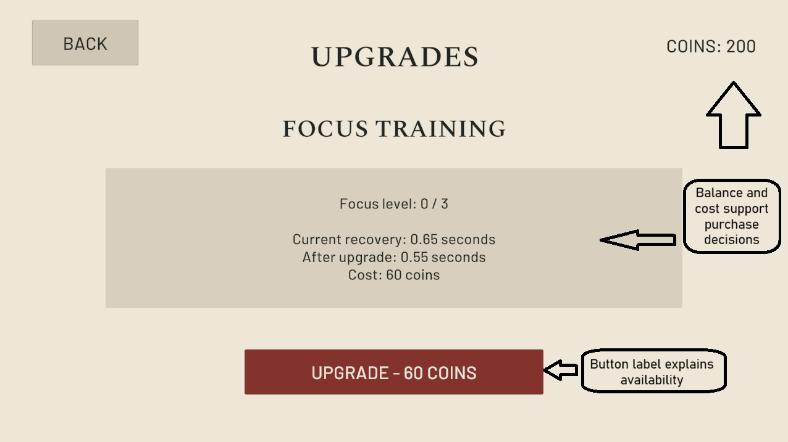

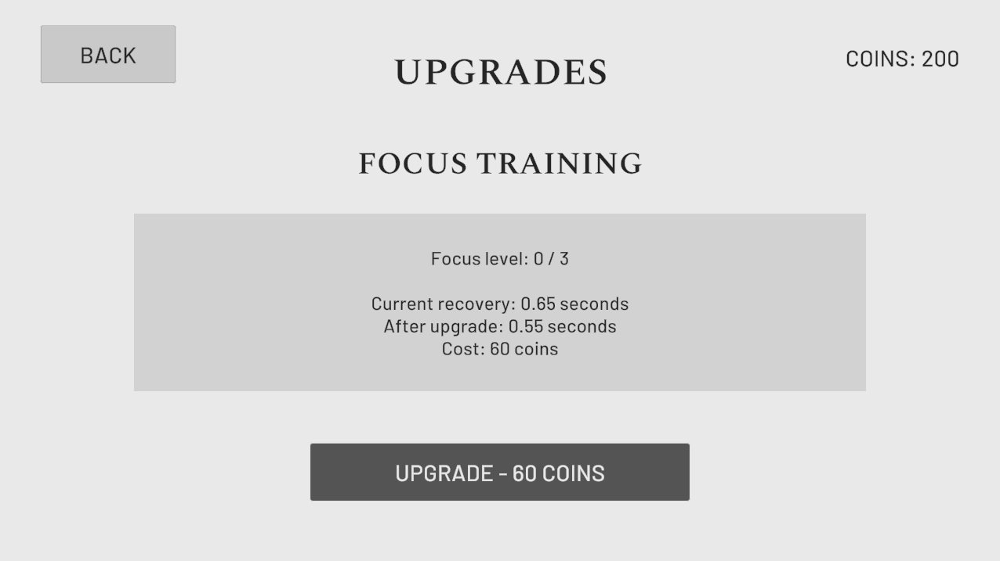

## 07 - Settings

**Purpose:** Adjust volume, control screen motion and test audio.

**Principles and techniques:** Large, separated controls support touch interaction. Labels explicitly show volume and motion settings. Test Sound provides audible feedback.

**Tweens and reason:** InCubic exit and OutCubic entrance maintain navigation consistency when motion is enabled. Screen Motion OFF makes screen changes immediate. OutQuad press and OutCubic release retain interaction feedback.

**Greyscale check:** Settings remain understandable through text, and controls remain distinguishable. No additional change was needed.

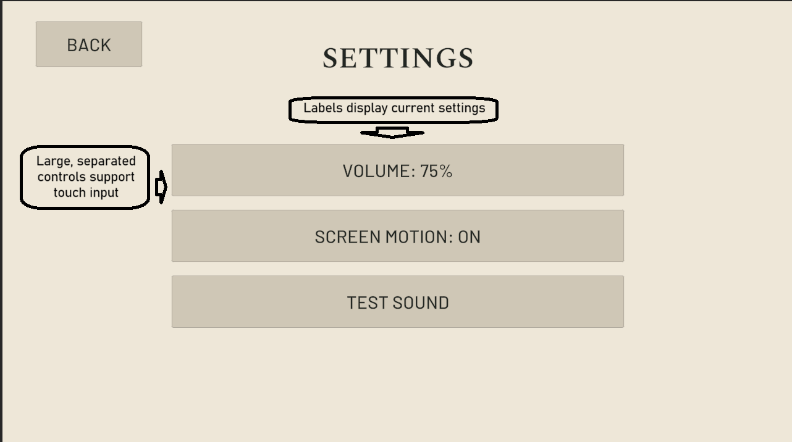

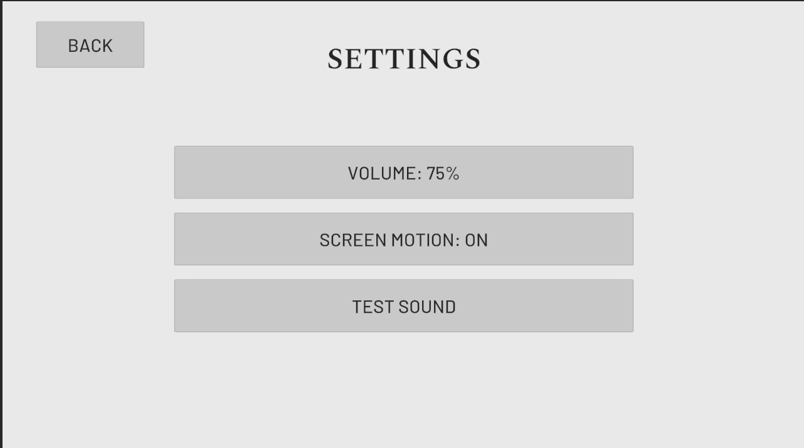

## 08 - Pause

**Purpose:** Suspend the mission and offer continuation or exit choices.

**Principles and techniques:** The Paused heading communicates state. Resume receives primary emphasis. Restart Mission and Main Menu provide clear alternatives.

**Tweens and reason:** InCubic exit and OutCubic entrance communicate the change from mission to menu. Unscaled updates preserve motion while gameplay time is stopped. Buttons use OutQuad press and OutCubic release.

**Greyscale check:** Resume retains emphasis, and all action labels remain readable. No additional change was needed.

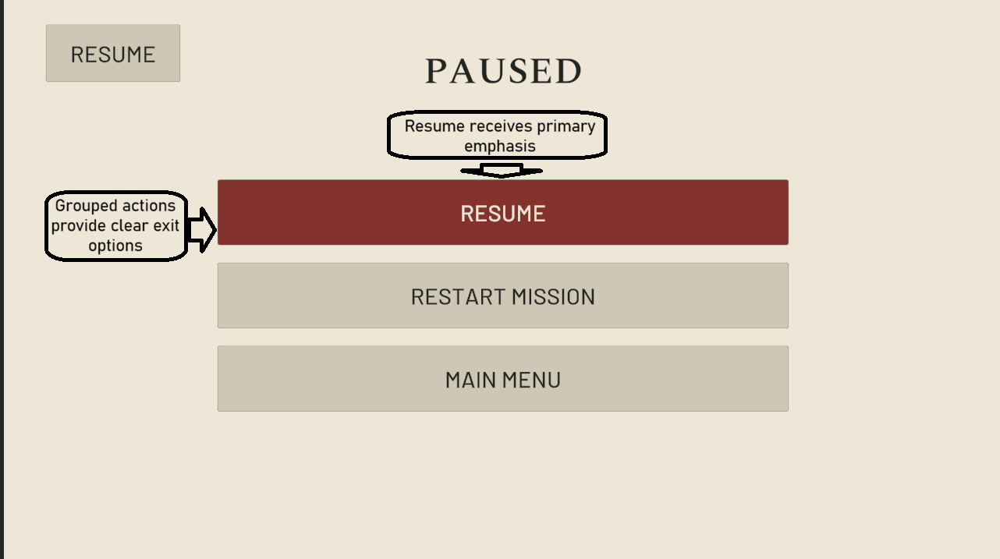

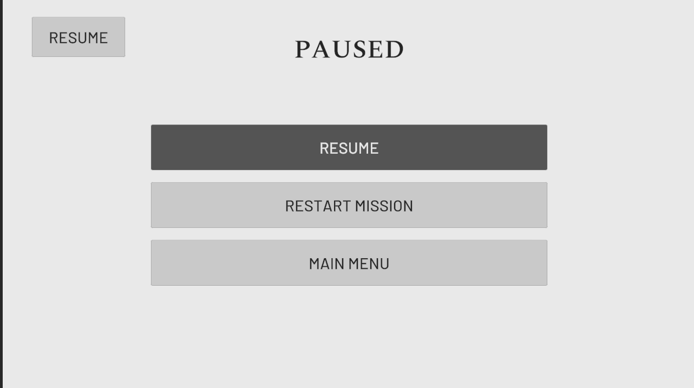

## 09 - Results

**Purpose:** Report mission success or timeout, performance and rewards.

**Principles and techniques:** A prominent outcome heading communicates the result through words. A card groups statistics. Retry and Main Menu provide onward navigation.

**Tweens and reason:** InCubic exit and OutCubic entrance separate the mission from its outcome. OutQuad press and OutCubic release acknowledge the next action.

**Greyscale check:** The outcome, statistics and actions remain readable. Retry retains primary emphasis. No additional change was needed.

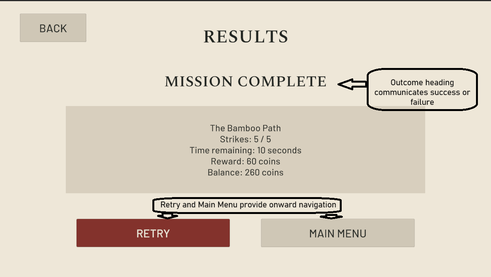

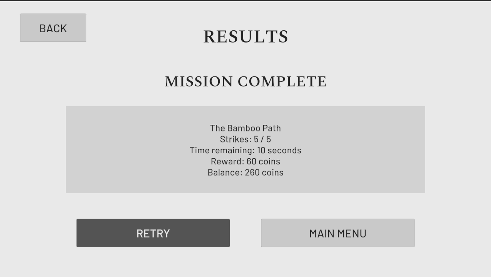

## 10 - Credits

**Purpose:** Identify the creator, visual references and third-party resources.

**Principles and techniques:** Heading sizes and grouped text establish information hierarchy. The consistent Back control provides a return route.

**Tweens and reason:** InCubic exit and OutCubic entrance preserve the shared navigation pattern. OutQuad press and OutCubic release acknowledge Back.

**Greyscale check:** Credits and Back remain readable against their surfaces. No additional change was needed.

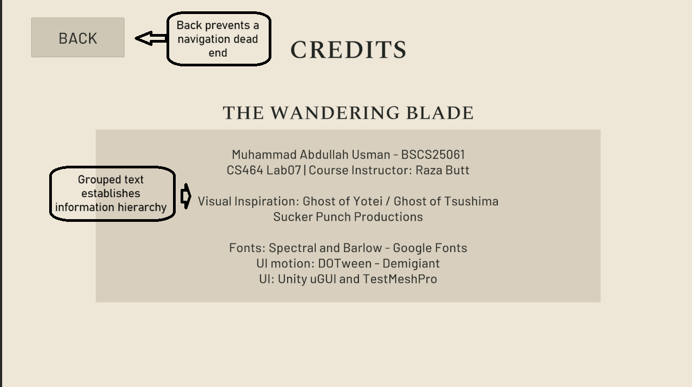

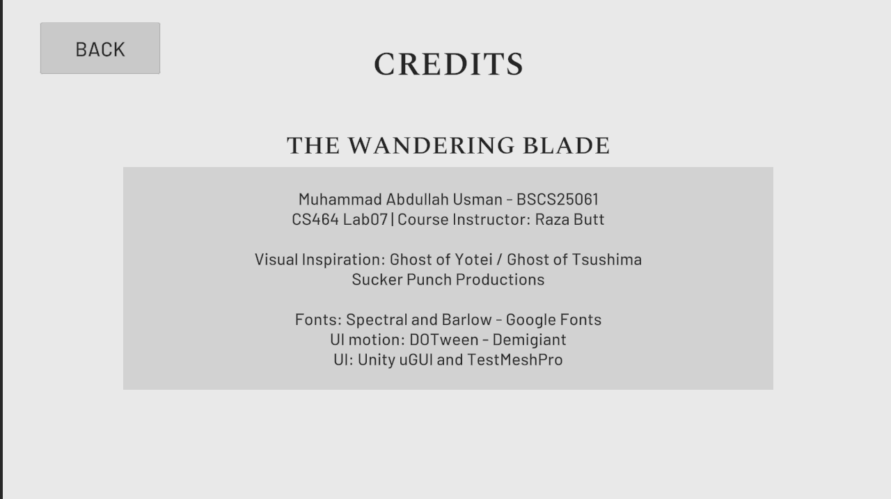

## Credits and References

- **Creator:** Muhammad Abdullah Usman - BSCS25061.
- **Course:** CS464 Game Development, instructor Raza Butt.
- **Course reference:** Lecture 08 - Colour UI & Menus.
- **Visual inspiration:** Ghost of Yotei and Ghost of Tsushima, by [Sucker Punch Productions](https://www.suckerpunch.com/). Referenced for atmosphere and restrained menus; no game artwork is included.
- **Heading font:** [Spectral - Google Fonts](https://fonts.google.com/specimen/Spectral).
- **Body and button font:** [Barlow - Google Fonts](https://fonts.google.com/specimen/Barlow).
- Font OFL licence files are retained alongside the fonts.
- **Motion library:** [DOTween - Demigiant](https://dotween.demigiant.com/), with its included licence retained.
- **Tween reference:** [DOTween documentation](https://dotween.demigiant.com/documentation.php).
- **UI tools:** Unity uGUI and TextMeshPro.
- **Test audio:** Generated in code; no external audio asset.
- **Images:** Captured from the implemented Unity interface. No AI/GPT-generated images are used.